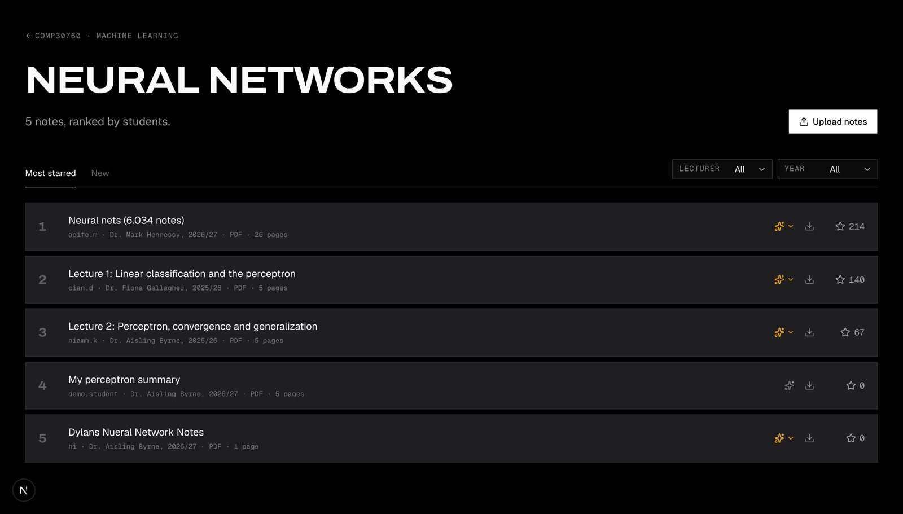
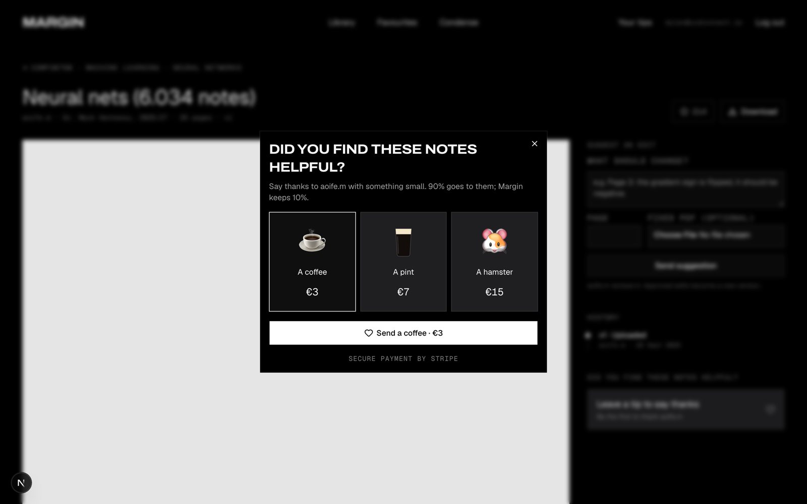

# Margin

**Where students share what they know.** Built for HackUCD 2026.

Students spend hours on notes, and after the exam they're never opened again. Margin gives those notes a second life: share them with your module, the best ones rise to the top, and the author gets tipped when they help someone. Condense then turns any lecture deck into notes written the way *you* write.


## What it does

| | |
|---|---|
| **Share** | Sign up with a student email, pick your course and modules, upload PDF notes to the modules you take. |
| **Rank** | Classmates star the notes that help. Topics list the most-starred first, with lecturer and year filters. |
| **Summarise** | ✨ on any note: AI reads the PDF and says what it covers and who it's for. |
| **Improve** | Suggest an edit → the author approves or rejects → every version stays in History. |
| **Tip** | Say thanks with a coffee (€3), a pint (€7) or a hamster (€15). 90% goes to the author, Margin keeps 10%. |
| **Condense** | Upload photos of your own handwritten notes → AI learns your style → drop in slides (PDF/PPTX) → get notes in that style. |



## How we use OpenRouter

Every AI call goes through one helper, `chatJson()` in [`margin/src/lib/openrouter.ts`](margin/src/lib/openrouter.ts): free models, JSON replies, and automatic fallback to the next model when one is busy.

| Feature | In → out | Code |
|---|---|---|
| ✨ Note summaries | PDF text → overview, what it covers, who it's for | `src/lib/summaries.ts` |
| Reading handwriting | photo of a notes page → transcript that keeps ink colours | `transcribe()` in `src/lib/condense.ts` |
| Your style | your notes → 3–5 traits of *how* you write, with quotes | `refreshStyle()` |
| Condense | slide text + your traits → structured notes (definitions, self-questions, rules, asides, highlights) | `condense()` |

## How we use Stripe

Margin is a marketplace, built on **Stripe Connect** (separate charges and transfers):

```
Student's card ──€7──▶ Margin (platform)
                         ├── 90% transfer ──▶ author's connected account ──▶ author's bank
                         └── 10% stays with Margin
```



1. **Payouts setup:** the author clicks *Set up payouts*; Margin creates a connected account (Accounts v2) and Stripe's hosted onboarding collects ID and bank details.
2. **Tip:** Stripe **Checkout** takes the payment. Card numbers never touch Margin.
3. **Webhook:** `checkout.session.completed` (signature-checked) records the tip.
4. **Transfer:** 90% goes to the author, tied to the original charge and protected by an idempotency key. If the author isn't set up yet, the tip is held and released once they finish.

Code: [`src/lib/payouts.ts`](margin/src/lib/payouts.ts), [`src/app/api/stripe/webhook/route.ts`](margin/src/app/api/stripe/webhook/route.ts), `startTip` / `setupPayouts` in [`src/app/library-actions.ts`](margin/src/app/library-actions.ts). Test mode only: `src/lib/stripe.ts` refuses live keys.

## Run it

```bash
cd margin
npm install
cp .env.example .env.local   # then fill in your own keys
npm run dev                   # http://localhost:3000
```

For tips, forward Stripe's webhooks locally:

```bash
stripe listen --events checkout.session.completed,checkout.session.async_payment_succeeded \
  --forward-to localhost:3000/api/stripe/webhook   # put the printed whsec_… in .env.local
```

Sign up with any student email (`@ucdconnect.ie`, `@tcd.ie`, `@mail.dcu.ie`, `@studentmail.ul.ie`, `@umail.ucc.ie`, `@universityofgalway.ie`). The demo verification code is `123456`. Stripe test card: `4242 4242 4242 4242`.

## Stack

Next.js 16 (App Router, Server Actions) · Tailwind v4 + shadcn/ui · OpenRouter · Stripe (Checkout, Connect, webhooks) · unpdf · jszip. Data is stored in local JSON files under `margin/.data/` (hackathon mock, gitignored); Supabase is the planned swap.

## Docs

- [How it works](margin/docs/HOW_IT_WORKS.md): the whole app explained, including the Stripe and OpenRouter flows
- [Decisions](margin/docs/DECISIONS.md): dated log of every product and technical choice
- [Project context](margin/docs/PROJECT_CONTEXT.md): handoff notes for contributors and AI agents

## Credits

Seed notes are real open lecture notes from MIT OpenCourseWare (6.867, 6.034, 6.824, 6.006), CC BY-NC-SA 4.0. Seed uploaders, stars and lecturer names are fictional. The landing photo is from Unsplash.
